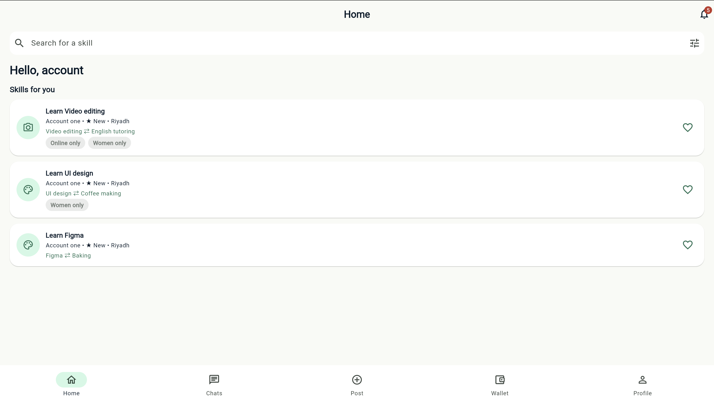
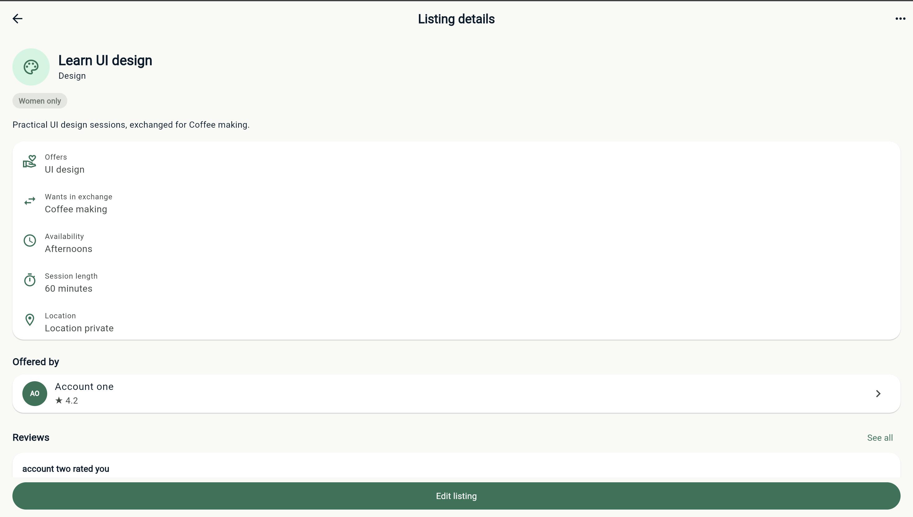
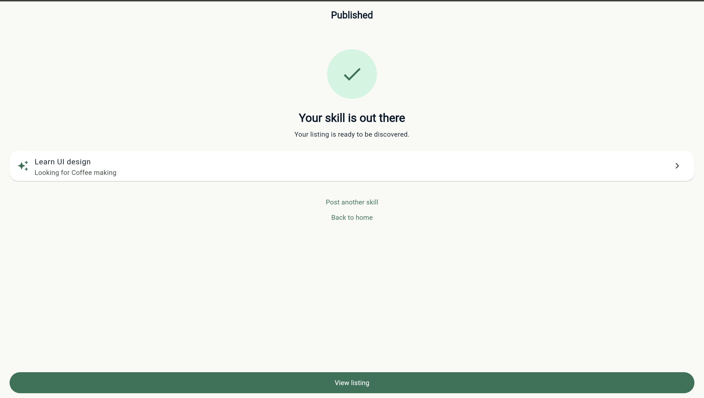
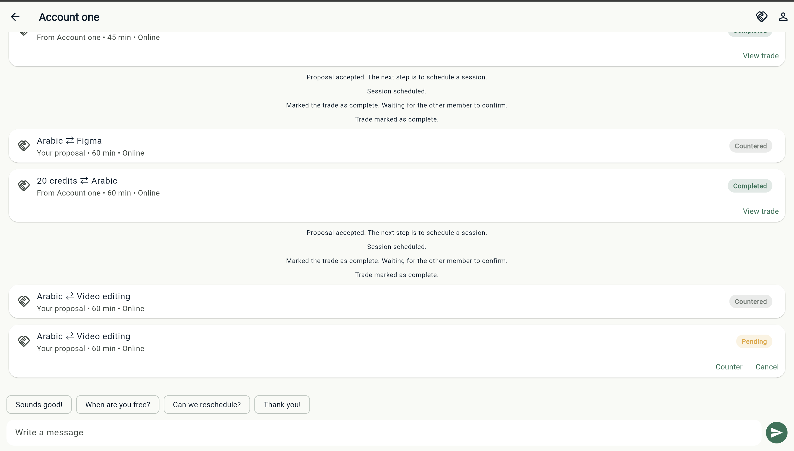
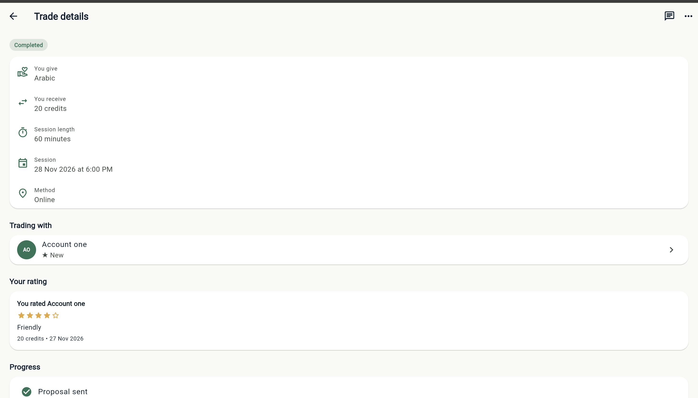
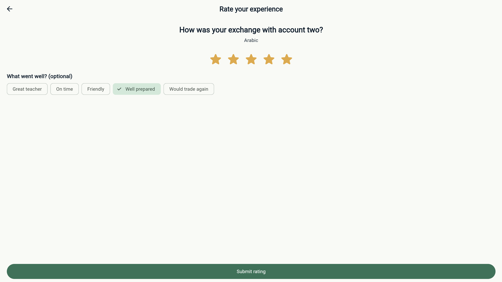
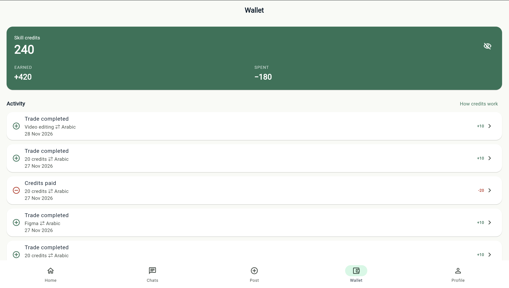
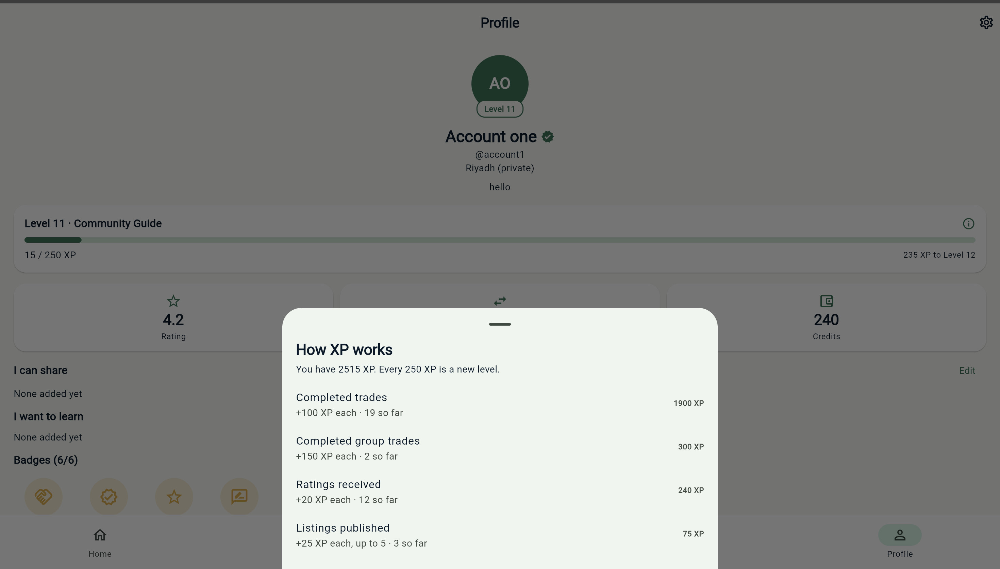
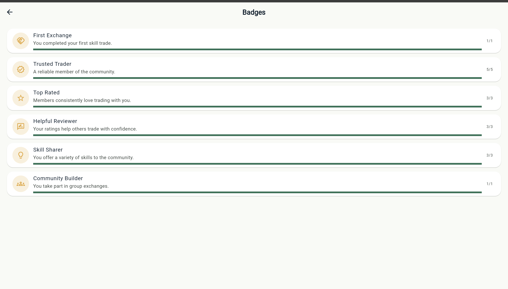
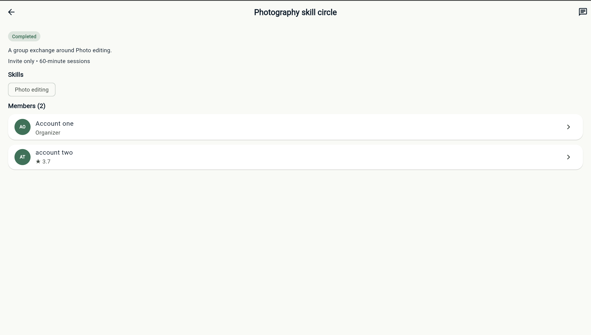

# Souq Skills

Souq Skills is a Flutter marketplace where members in Saudi Arabia trade skills instead of money. Post what you can teach, propose a swap, schedule a session, complete it, and rate the experience. The goal is to let people learn and share skills through exchange, without monetary payment.

**Course:** SWE463 — Phase 4 Final Application and Demonstration.

**Documentation reviewed:** 28 November 2026 against `main` at [`ef5de41`](https://github.com/Wajza/swe463-project/commit/ef5de4108c6c65acab7aaa671adaf6ad9f0e35fd). Feature descriptions below describe the implementation in that revision; deployment and test evidence have their own dates and commits.

**Release status:** the historical `phase-3` tag exists. The required `final-submission` tag and the final APK download link are **pending** in this README. Create the final tag only after the team verifies the submitted revision; then add its exact commit, release/APK link if required, and final test results. The screenshot gallery is available under [Screenshots](#screenshots).

## Team

| Member | Student ID | Main responsibilities |
|---|---:|---|
| Wajd Alghamdi | 202262140 | UI/UX, shared frontend and navigation, Phase 4 UI states and XP presentation, integration and demonstration coordination |
| Yasmeen Alshehri | 202271660 | Authentication and profile/listing data, privacy, ratings and eligibility, Firestore rules, regression testing |
| Fatimah Alshehab | 202278660 | Chat, trades, wallets and groups, settlement and account reliability, Android release preparation, form keyboard actions |
| Raghad Almaghrabi | 202156390 | Original assigned frontend features; Phase 4 UI quality, manual Chrome checks, regression verification and report evidence |

See [Contribution record](#contribution-record) for completed work and evidence. These responsibilities overlap; integration commits do not transfer ownership of another member's original work.

## Feature status

### Approved essential features

All eight features below are implemented in the reviewed code. This is a code-level status, not a claim that this documentation review reran the app, verified the deployed Firebase rules, or tested a final release. Remaining limitations are listed below.

| # | Feature | Implementation and storage |
|---|---|---|
| 1 | Create and manage skill listings | Selection-based posting; required category, offered skill and different requested skill; publish, edit, pause, resume and confirmed deletion. Real-member listings use Firestore `listings`. |
| 2 | View listing details and reviews | Selected listing, owner and reviews; public-profile visibility respected. Firestore `listings`, `publicProfiles` and `reviews`. |
| 3 | Browse, search and filter | Other members' active listings; local search over loaded title/offered/requested skills; category, city and Online only / Women only tag filters; pull to refresh. Firestore `listings`. |
| 4 | Earn and use skill credits | 120 welcome credits once; +10 per completed direct trade and +15 per completed group trade. Offered credits are held for active trades and settled on completion. Firestore `wallets` and transaction ledgers. Rewards are per completion, not per hour. |
| 5 | Propose trades through in-app chat | Real-time direct messages and proposal cards between real members. Firestore `conversations`, messages, `trades` and `proposals`. |
| 6 | Negotiate and confirm agreements | Counteroffer, accept, decline and cancel; agreed terms and session scheduling/rescheduling. Accepted cards follow the linked trade's status. Firestore `trades` and `proposals`. |
| 7 | Complete trades and rate participants | Both direct-trade participants confirm before settlement. Ratings are once per reviewer, exchange and subject; a later completed trade with the same member can be rated again. Completed group trades allow rating each other participant. Firestore rules require a completed exchange containing both members. |
| 8 | Levels and badges | Profile XP, level/title, progress and source breakdown, plus six activity-based badges. Derived from loaded trades, group trades, ratings and listings; XP is not stored as a separate editable field. |

### Approved optional features

| Optional feature | Code status | Scope |
|---|---|---|
| Saved skills/listings | Completed | Saved per real member in Firestore; save/unsave and refresh handling. |
| Matching-listing alerts | Not completed | Existing in-app chat/trade notifications are not matching-listing alerts. |
| Group trades | Completed | Invite-only groups, invitations, group chat, completion confirmations, rewards and participant ratings. |
| Reports and disputes | Completed, with limitations | Reports, complaints and trade-dispute submission with Safety Centre tracking; moderation requires trusted administration. Trade-target validation limitations are documented below. |

### Other areas

| Area | Features |
|---|---|
| Account | Phone sign-in or sign-up from one entry point with Firebase Authentication (SMS code), first and last name, username unique across all members, location from a list or the device, private location option, editable profile and skills saved to Firestore, code verification for a new phone number, sign out, delete account after verifying the phone number again (also removes the member's listings, saved skills, blocks, profile, public profile and username; ratings and reports are kept) |
| Discover | Saved skills kept per member |
| Posting | Group trades from the same page of selections |
| Trading | Offering a skill or wallet credits, scheduling and rescheduling a session, completion, disputes |
| Profile | Level and XP progress, rating, badges earned from activity, reviews given and received, skills |
| Group trades | Invite only: create, invite by username, accept or decline, group chat, completion once every member confirms, rating |
| Chat | Direct and group chats with one-tap replies |
| Wallet | Balance, credits on hold for active trades, hide or show, earned and spent totals, transaction history with details |
| Notifications | In-app notifications for messages, proposals, counteroffers, sessions, group invitations and completions, following the notification switches in Settings |
| Safety | Report a member or trade with optional details (sent online, once per member or trade), optionally block the member afterwards, send a complaint and get a confirmation, block and unblock, track cases in the Safety Centre |
| Settings | Edit profile, dark mode and notification switches, Public profile, blocked members, help and policies. Location privacy is edited with the profile. Public-profile and location-visibility choices are saved online; appearance and notification switches remain device settings. |

**End-to-end trade flow with stored results:** Account 2 messages Account 1 from a listing → proposes a trade in the chat → Account 1 sends a counteroffer → Account 2 accepts → a session is scheduled → both members confirm completion → both wallets are updated. Each step is saved in Firestore and seen by both members.

## Screenshots

Screenshots of the running Souq Skills application in Chrome on macOS. These images document the captured interface; automated test results are recorded separately in the Testing section.

See the [screenshot index](docs/screenshots/README.md).

### Home

Skill listings, search, filters and navigation.



### Listing details

Selected listing and trade proposal action.



### Posting validation

Required-field validation in the posting form.



### Chat and proposal

Trade conversation and proposal state.



### Completed trade

Completed exchange and its result.



### Rate an experience

Rating form for an eligible completed exchange.



### Skill wallet

Loaded credit balance and transaction history.



### Profile and XP

Profile information, level and XP.



### Badges

Badge progress and requirements.



### Group trade

Group members and invitation or completion state.



## Run the app

### Requirements

- Flutter SDK with **Dart 3.13.4 or newer** (`pubspec.yaml`: `sdk: ^3.13.4`). The existing team documentation records Flutter 3.47.9 (stable); record the actual SDK used for final verification with `flutter --version`.
- Git and Google Chrome.

### Steps

```bash
git clone https://github.com/Wajza/swe463-project.git
cd swe463-project/souq_skills
git switch main
git pull --ff-only
flutter pub get
flutter run -d chrome
```

The app starts through `AppGate`, restoring saved authentication/data. A new session without a signed-in account reaches the welcome screen; a restored account loads its profile before Home. The configured Firebase project is `souq-skills`.

For the exact code reviewed here, run `git checkout --detach ef5de4108c6c65acab7aaa671adaf6ad9f0e35fd` before `flutter pub get`. Use `git checkout final-submission` instead only after that tag exists and has been verified by the team. `main` may change after this review.

### Firebase setup

The committed client options select the team project; the app does not currently require a `.env` file or app-specific `--dart-define` values. A different Firebase project requires regenerating/replacing the client options and configuring its authentication and rules.

- **Chrome:** the client configuration is committed in `lib/firebase_options.dart`; `google-services.json` is not used on the web. Running against the team's already configured project does not require downloading a configuration file. It still requires network access, an available Firebase project, enabled phone authentication, suitable authorized domains and deployed rules; Firebase test numbers must be configured by a project owner.
- **Android: extra configuration is needed.**
  - The Android build applies the Google Services Gradle plugin, so it needs `android/app/google-services.json`. This file is deliberately excluded by `.gitignore`; download it from the Firebase Console (Project settings → Your apps) or run `flutterfire configure`.
  - For phone sign-in, the SHA-1 and SHA-256 fingerprints of the machine building the app must be added in the Firebase Console.
  - Without these, run the app in Chrome instead.
- **Project owners only:** the Phone sign-in provider must be enabled in the Firebase Console, and the Firestore rules deployed (see *Security rules*).

### Android release APK

The Android Gradle project supports release signing with a local team keystore. Fatimah's contribution record reports signature, installation, launch and phone-sign-in checks on an Android Emulator. The final release APK download link and its matching commit/tag are pending in this README; these build instructions alone do not verify the final APK. The app is not documented as published on the Play Store.

**1. Release key (once per team).** Create a keystore *outside* the repository and keep a backup: an update to an installed APK must be signed with the same key.

```bash
keytool -genkeypair -v -keystore C:/Users/<you>/.souq-skills/souq-skills-release.jks -storetype PKCS12 -alias souq_skills -keyalg RSA -keysize 2048 -validity 10000
```

Then create `souq_skills/android/key.properties` pointing at it:

```properties
storeFile=C:/Users/<you>/.souq-skills/souq-skills-release.jks
storePassword=<keystore password>
keyAlias=souq_skills
keyPassword=<key password>
```

Never commit `key.properties`, the keystore or its passwords; `android/.gitignore` already ignores `key.properties`, `*.jks` and `*.keystore`. Without `key.properties`, release builds fall back to the debug key, which is only suitable for local testing.

**2. Build from the repository root.**

```bash
cd souq_skills
flutter pub get
flutter analyze
flutter test
flutter build apk --release
# build/app/outputs/flutter-apk/app-release.apk
```

**3. Verify the signature** (Android SDK build-tools):

```bash
apksigner verify --verbose --print-certs build/app/outputs/flutter-apk/app-release.apk
```

It should print `Verifies` and the certificate for the intended release keystore, rather than `CN=Android Debug`.

**4. Install** from `souq_skills/` on a device/emulator with USB debugging: `adb install -r build/app/outputs/flutter-apk/app-release.apk`. Alternatively, copy the APK to a phone and allow installation from that source.

**Notes**

- The build needs `android/app/google-services.json` (see *Firebase setup*). The application id stays `com.example.souq_skills`, the one registered in Firebase; changing it needs a new Android app in the Firebase Console and a new `google-services.json`.
- **Phone sign-in:** add the release key's SHA-1 and SHA-256 fingerprints (from the `apksigner` output, or `keytool -list -v -keystore <keystore>`) to Firebase Console → Project settings → Your apps → Android app, then download the updated `google-services.json` and rebuild. Without them, phone sign-in in the release APK can fail on a device.
- **Emulators:** on some Android emulators with integrated host GPUs, Flutter's default Impeller renderer draws text and icons incompletely. The same build renders correctly with the Skia renderer, so this is an emulator graphics issue; check the APK on a real phone.

### Test accounts

| Account | Phone number (without +966) | Verification code |
|---|---|---|
| Account 1 | `501234567` | `123456` |
| Account 2 | `507654321` | `123456` |

Use these course test accounts only for the demonstration. Their current availability is controlled by the team's Firebase project, not by the repository. Both numbers must be listed, with the code `123456`, under Firebase Console → Authentication → Sign-in method → Phone → *Phone numbers for testing*. Firebase then accepts the code without sending an SMS. (In the offline test mode used by `flutter test`, where Firebase is not initialized, the code `123456` is accepted for any number.)

### Signing in

1. Press **Get started**.
2. Enter the phone number without `+966` and press **Continue**. If a reCAPTCHA check appears, complete it.
3. Enter the 6-digit code and press **Verify**.
4. A number with no account yet goes on to **Create account**: enter a first name, last name, username and location, then press **Create account**.

**Two accounts at the same time:** sign in to Account 1 in a normal Chrome window. Open the app's address (shown by `flutter run`, for example `http://localhost:xxxxx`) in a Chrome **Incognito** window and sign in to Account 2. Tabs of the same window share one sign-in, so they cannot be used for this.

### Security rules

The Firestore rules are in `firestore.rules`. Only project owners deploy them, after the rules tests pass:

```bash
firebase deploy --only firestore:rules --project souq-skills
```

### Resetting

To clear what is kept on one device, clear the browser's site data or the app's storage. Accounts, profiles, public profiles, usernames, listings, saved skills and blocks live in Firestore and are removed with **Delete account**; reports and ratings sent online are kept.

## Final demonstration

Use the same commit/tag as the submitted application. `DEMO.md` is a rehearsal plan, not proof that a final demonstration or release has been verified. Recheck the presenters and any test counts before presenting.

The run sheet for the final demonstration, with the order, accounts, suggested presenters and a pre-demo checklist, is in [DEMO.md](DEMO.md).

## Final submission checklist

- Confirm all approved essential features work end to end on the intended final commit, including per-exchange ratings and shared data updates.
- From `souq_skills/`, run `flutter pub get`, `dart format --output=none --set-exit-if-changed lib test`, `flutter analyze` and `flutter test`; record tool versions, commit SHA and output. Run the rules tests separately.
- Verify a clean-checkout build, required validation/failure states, and phone-sized/wide layouts. If an APK is required, install and launch the exact build being submitted and verify phone sign-in.
- Add current screenshots, resolve pending README/report fields and verify repository/release access. Do not include local signing credentials, caches or build directories in Git.
- Only after verification, create and push `final-submission` at that commit. Verify the tag resolves to the tested SHA and use it for the report, APK and demonstration. Do not alter the submitted tag after the deadline without instructor permission.

## Testing

### Automated

From the repository root:

```bash
cd souq_skills
flutter analyze
flutter test
```

`flutter test` needs no Firebase connection. Without an initialized Firebase app, the app uses in-memory stand-ins for each Firebase repository (for example `DemoAuthRepository`, `DemoProfileRepository`, `DemoListingRepository`, `DemoTradeRepository`, `DemoWalletRepository`, `DemoChatRepository`), and the tests that cover Firestore behaviour inject them directly. The latest team-recorded result in the contribution evidence is **557 Flutter tests passed** with no analyzer issues at `42b5638` (27 November 2026). This is a recorded result, not a new run performed by this README review. Earlier counts below belong to earlier commits and must not be presented as final-release verification.

| Evidence | Revision and date | Result |
|---|---|---|
| Latest team-recorded Flutter run | `42b5638`, 27 November 2026; reported in Fatimah's contribution record | 557 passed; analysis reported no issues. |
| Latest team-recorded rules run | 27 November 2026; existing rules-test record | 218 passed, 0 failed. |
| Raghad's own earlier UI verification | `ace4b58`, 26 November 2026 | Analysis: no issues; 4 targeted state tests passed; complete Flutter suite: 457 passed. Manual checks passed in phone-sized and wide Chrome layouts on a Mac. This predates the latest rating, settlement and keyboard changes. |

Run the full suite again on the final candidate, record `git rev-parse HEAD`, tool versions and results, and verify the same commit after tagging. Flutter widget tests use controlled repositories; they do not prove that production Firebase rules are currently deployed or that the release APK works.

| Test file | Covers |
|---|---|
| `test/widget_test.dart` | Welcome screen, phone and code validation, bottom navigation |
| `test/app_flow_test.dart` | Home search and filters, rating flow through to the profile, solo and group posting, form validation, proposal to trade, new accounts |
| `test/profile_and_group_test.dart` | Counteroffers from the card, sign-up validation, unique usernames, device location, phone re-verification, group invitations, listing tags |
| `test/credits_and_complaints_test.dart` | Offering credits, holds, payment on completion, release on cancel, Edit profile location, complaints |
| `test/persistence_test.dart` | Save and restore, corrupt data, loading, load failure with retry, save failure with retry |
| `test/routes_test.dart` | Every route on a phone screen in light and dark themes, one main button per screen, missing arguments |
| `test/profile_repository_test.dart` | Profile data conversion, username claims, case-insensitive uniqueness, renames |
| `test/profile_loading_test.dart` | Loading the profile after sign-in and at start-up, failures, account switching on one device |
| `test/profile_saving_test.dart`, `test/my_skills_saving_test.dart` | Saving profile edits and skills online first, failures, unchanged fields |
| `test/sign_up_username_test.dart` | Claiming a username at sign-up, taken names, releasing it on account deletion |
| `test/listing_repository_test.dart` | Listing data conversion, owner ids, older records, ownership checks |
| `test/listing_writes_test.dart` | Publishing, editing, pausing and deleting online first, failures, ownership, group trades unchanged |
| `test/listing_loading_test.dart` | Loading and refreshing listings, empty and error states, account switching, search and filters on loaded listings |
| `test/saved_listings_repository_test.dart`, `test/saved_listings_test.dart` | Saving per member, failures, rapid taps, refresh, sign-in again, account switching, deleted listings |
| `test/account_deletion_cleanup_test.dart` | Deleting an account removes only its own listings and saved skills, and stops safely if that fails |
| `test/account_deletion_reauth_test.dart` | Verifying the phone number again before deleting: success, a wrong code, going back, a code that cannot be sent, the time limit, and that no account data is removed until it succeeds |
| `test/public_profile_repository_test.dart` | What a public profile shares (never the phone), hidden profiles and locations, reading other members |
| `test/public_profile_test.dart` | Publishing at sign-up, edits and the *Public profile* switch, owner names on listings, fetching each member once, failures, account switching, publishing older accounts at sign-in |
| `test/blocked_members_repository_test.dart`, `test/blocking_test.dart` | Blocking and unblocking online first, what a block hides (Home, Saved skills, listing details, profiles), the Blocked members screen, load failures with retry, account switching, account deletion, and chat and group-invite filters |
| `test/report_repository_test.dart`, `test/reports_test.dart` | What a report stores, fixed ids and duplicates, reporting members, trades and complaints online first, failures and retry, optional details and blocking afterwards, the online dispute method, the Safety Centre states, account switching, and keeping reports after account deletion |
| `test/review_repository_test.dart` | Per-exchange/per-subject review IDs, legacy reviews and duplicate handling, field validation and visibility |
| `test/ratings_test.dart` | Rating real members online first, per-exchange/per-group-participant ratings, failures/retry, loading, visibility, deleted accounts and badges |
| `test/chat_test.dart` | Conversation ids and message validation, both members seeing the same chat, live replies, unread counts and notifications, blocking, account switching, demo members |
| `test/trades_test.dart` | Proposals, counteroffers, accepting, declining and cancelling between two members, sessions, completion only after both confirm, live updates, blocking, demo members, offline mode |
| `test/wallet_test.dart` | Opening a wallet with the welcome credits, settlement on completion, who pays, short balances, no double payment, both members or one member confirming at the same time, refused completions changing nothing, members outside a trade, group rewards claimed at once, the ledger always adding up to the balance, countering a credit offer, live balance, account switching |
| `test/group_trades_test.dart` | Group trades online: invitations, completion once every member confirms, rewards, leaving and removal, the group chat, the Community Builder badge count, account switching |
| `test/account_switch_and_trade_action_test.dart` | Demo-member replies never reaching the next account; trade changes showing progress, refusing a second tap, explaining failures in words and never staying stuck loading |
| `test/notifications_test.dart` | Notifications for group trades, proposals, counteroffers, sessions and completions; settings and blocks respected; opening and marking notifications read |
| `test/trade_details_reschedule_test.dart` | Rescheduling a session from the trade's session card |
| `test/frontend_a_integration_test.dart` | Skill credits explanation, wallet totals and transaction details, listing reviews page, published screen, profile skills, Safety Centre |
| `test/load_states_test.dart`, `test/experience_and_states_test.dart` | My Trades/Wallet loading, failure and retry; no premature zero balance; XP calculations and shared load states |
| `test/rate_trade_loading_test.dart` | Rating page waits for the relevant exchange data and handles loading/failure |
| `test/proposal_card_status_test.dart` | Accepted proposal cards reflect the linked trade's later status |
| `test/enter_submits_form_test.dart` | Enter/keyboard actions, focus movement, validation and duplicate-submit protection |

### Firestore security rules

From the repository root, run the following commands. The rules in `firestore.rules` are tested against the Firestore emulator. This needs a Node.js version compatible with the locked Firebase packages, Java 21 or newer, and the Firebase CLI. It runs against a local `demo-` project, so nothing reaches the real one. On 27 Nov 2026, all 218 rules tests passed (0 failed), including both members confirming a trade at the same time and stale confirmations.

```bash
cd souq_skills
npm --prefix firestore_rules_test ci    # use the committed lockfile
firebase emulators:exec --only firestore --project demo-souq-skills "npm --prefix firestore_rules_test test"
```

`firestore_rules_test/rules.test.mjs` repeats the app's own Firestore reads and writes. It checks what members may do and what is refused for:

- profiles and public profiles;
- usernames;
- listings;
- saved listings;
- blocked members;
- reports;
- reviews, and the *Public profile* switch that hides them;
- account deletion cleanup;
- direct chats and their messages;
- trades and proposals;
- wallets and their transactions;
- group trades and their chat.

### Manual

These steps use the two test accounts. Prepare Account 1 to offer **Baking** and Account 2 to offer **Piano** using Profile → My skills if necessary. Saved accounts may already contain trades and transactions. Run them in order: the wallet step needs an accepted, scheduled and completed trade.

1. **Sign in** as Account 1 (see *Signing in*). Enter `123` first and confirm the validation message.
2. **Create and manage a listing (Account 1):** press **Post** and press **Publish** with nothing selected to see the errors. Choose **Cooking** and **Baking**, then **Piano** as *Skill you want in exchange* and **Riyadh** as the city, and press **Publish**. Press **View listing** → **Edit listing**, change the session length and press **Save changes**. Open **Edit listing** again and use the **⋮** menu to **Pause listing**, then **Resume listing**. Post a second listing and delete it from the **⋮** menu (**Delete listing** → **Delete**).
3. **Browse, search and filter (Account 2):** sign in as Account 2 in an Incognito window. On Home, type `baking`; only matching listings remain. Clear it, press **Filter**, choose **Cooking**, then **Riyadh**, then change the city to **Jeddah**; Account 1's listing disappears.
4. **Listing details and reviews (Account 2):** open Account 1's listing. Its details, owner and **Propose a trade** are shown. **See all** is offered in Listing Details when review previews exist; otherwise open the owner's public profile to inspect the rating/review state. Hidden reviews remain private.
5. **Propose through chat (Account 2):** on the listing, choose **Message member** from the **⋮** menu and send a message. In the chat, press the **Propose a trade** icon, choose *You offer* → **My skill** (Piano) and *You want* → **Baking**, then press **Send proposal**. Account 1 sees the message and the proposal card in **Chats**.
6. **Counteroffer (Account 1):** press **Counter** on the card, change the session length (for example 60 → 90 min) and press **Send counteroffer**.
7. **Accept (Account 2):** press **Accept** on the counteroffer card. Both accounts see the trade in **Profile → My trades** with the agreed terms.
8. **Decline (optional):** send another proposal from Account 2; Account 1 presses **Decline** and confirms. It can no longer be accepted.
9. **Offer credits, schedule and complete:**
   - Note both wallet balances (120 for a new account).
   - Account 2 sends a new proposal with *You offer* → **Credits** and **20 credits**; Account 1 presses **Accept**. Account 2's wallet shows the 20 credits on hold.
   - Open the trade (**View trade**), press **Schedule session**, pick a future date and time, and press **Save session**.
   - One account presses **Mark as complete**; the other presses **Confirm completion**.
10. **Wallet:** open **Wallet** on both accounts. Compare with the balances recorded immediately before this credit-funded trade: Account 1 gains 30 (+10 reward, +20 received), and Account 2 loses 10 (+10 reward, −20 paid). If both started at 120 and nothing else changed, the balances are 150 and 110. Do not assume reused accounts still start at 120. Check the corresponding Activity entries.
11. **Rate:** on the completed trade, press **Rate this experience**, choose stars and optional tags, and press **Submit rating**. The trade shows *Your rating*. The same member can be rated for another completed trade; a second rating of the same member for the same exchange is refused. In a completed group trade, return to its details to rate each remaining participant. An unfinished or unrelated exchange must not allow a saved rating.
12. **Complaint:** Profile → Settings → Help and support → **Send a complaint**, pick a topic and send. A message confirms you will get feedback soon, and the complaint appears in the Safety Centre.
13. **Change phone:** Profile → Settings → Edit profile, change the phone number, press **Save**, and verify the code.
14. **Persistence:** close and reopen the app. You stay signed in and your changes remain.
15. **Back behaviour:** on Android, Back from any tab returns to Home before leaving the app.
16. **Keyboard and privacy regression checks:** use Enter on phone/verification fields; in account creation and Edit profile, check Next focus movement and final-field submission. Invalid input must still be blocked and repeated Enter must not duplicate requests. Change profile/location visibility, sign in to the same account in another isolated session, and check the saved choices are respected.
17. **Delete account (last; only on a disposable test account):** Profile → Settings → **Delete account**, then enter the code sent to the account's phone number. The account's listings disappear for other members, and its username can be taken again.

## Architecture

```text
souq_skills/lib/
├── main.dart, app.dart   # Entry point and app configuration
├── core/                 # Routes, router, theme, validators, options, formatters
├── models/               # Immutable data classes with JSON support
├── data/                 # Firebase access: auth, profiles, listings, saved listings, blocked members,
│                         # reports, reviews, chats, trades and proposals, group trades, wallets
├── services/             # Business rules, repository, data source, live online data
├── screens/              # One folder per feature
└── widgets/              # Reusable design-system components
```

**State ownership.** `Repository` is the shared `ChangeNotifier` for the app snapshot. Services and `OnlineTrades`, `OnlineWallet` and `OnlineGroups` also own live online data and load state; some services expose `ValueNotifier`s. Screens subscribe through `LiveView`, `LiveEntity` and explicit notifiers. Temporary form input uses widget `State`/controllers. The integrated app does not depend on Provider; Provider belongs only to the historical frontend branch.

### Data source

Shared data is kept in Firebase, each part behind an interface in `lib/data/` with a Firebase version and an in-memory one for tests:

| Data | Where | Interface |
|---|---|---|
| Sign-in | Firebase Authentication (phone) | `AuthRepository` |
| Profiles | Firestore `users/{uid}`, private to the member | `ProfileRepository` |
| Public profiles | Firestore `publicProfiles/{uid}`: names, username and, unless *Public profile* or the location is off, city, bio, skills and availability; never the phone. Saved in the same transaction as the profile, readable by signed-in members one at a time | `ProfileRepository`, `MemberService` |
| Usernames | Firestore `usernames/{username}`, claimed in the same transaction as the profile | `ProfileRepository` |
| Listings | Firestore `listings/{listingId}`, with the owner's uid | `ListingRepository` |
| Saved skills | Firestore `users/{uid}/saved/{listingId}`, private to each member | `SavedListingsRepository` |
| Blocked members | Firestore `users/{uid}/blocked/{blockedUid}`, private to the member who blocked; only real accounts, never oneself. Blocks of the built-in demo members stay on the device | `BlockedMembersRepository`, `SafetyService` |
| Reports | Firestore `reports/{reportId}`; see *Reports* below | `ReportRepository`, `SafetyService` |
| Reviews | Firestore `reviews/{reviewId}`; see *Ratings and badges* below | `ReviewRepository`, `ReviewService` |
| Direct chats with real members | Firestore `conversations/{dm_smallerUid_largerUid}` with the latest message and each member's read time, and its `messages/{messageId}` by uid only, including proposal cards. Readable by the two members only; messages are never changed or deleted. Live while signed in | `ChatRepository`, `ChatService` |
| Trades and proposals with real members | Firestore `trades/{tradeId}` and `proposals/{proposalId}`, by uid only; a proposal and its trade are written together, and a counteroffer is a new proposal on the same trade. Readable and changeable by the two members only. Scheduled sessions are saved on the trade, which completes only once both members confirm. Live while signed in | `TradeRepository`, `OnlineTrades`, `TradeService`, `ProposalService` |
| Group trades | Firestore `groupTrades/{groupId}`, readable by its members and invited members, and its `messages/{messageId}` group chat. A group completes once every member confirms. Live while signed in | `GroupTradeRepository`, `OnlineGroups`, `GroupTradeService` |
| Wallets | Firestore `wallets/{uid}` (the balance) and its `transactions/{entryId}` ledger. Opened once with 120 welcome credits; a trade's completion settles both wallets in the same transaction (+10 each, and any credits offered move from the payer to the other member); +15 for each member of a completed group trade. The rules allow only these exact changes | `WalletRepository`, `OnlineWallet`, `WalletService` |

**Reports.** Each report is one document in the top-level `reports` collection:

| Field | Value |
|---|---|
| `reporterId` | The reporter's Firebase uid |
| `kind` | `memberReport`, `tradeReport`, `tradeDispute` or `complaint` |
| `reason` | One of the fixed reasons offered (at most 60 characters) |
| `details` | Optional, at most 500 characters; left out when empty |
| `memberId` | Member reports only: the reported member's uid |
| `tradeId` | Trade reports and disputes only: the trade's id as the reporter's app knows it |
| `listingId` | Optional, when a listing is involved |
| `status` | `submitted` when sent |
| `createdAt` | Server time |

- **One report per target.** A member report, trade report or dispute has the fixed id `{reporterUid}_{kind}_{targetId}`, so the same member or trade can be reported once per kind, even after it is resolved. The app says "You already reported this member" (or trade), and the rules refuse a second one too. Complaints get a new id each.
- **Security.** Only the reporter can read their own reports, and lists must be filtered by their `reporterId`. Nobody can change or delete a report from the app. Reports cannot be sent as someone else, about oneself, or about an account that does not exist (demo ids included).
- **Moderation.** Changing a report's status needs trusted server-side access (the Admin SDK or the Firebase Console); the app only reads it.
- **Account deletion keeps reports.** They stay for moderation after the reporter or the reported member deletes their account.
- **Demo members.** Reports about the built-in demo members, and every report in the offline demo, stay on the device, with the same once-per-target rule.
- **Sent first, shown after.** A report is only shown as received, and the Safety Centre only lists it, once it has been saved online. After reporting a member, blocking them is offered but never done automatically; if blocking fails, the report still counts.

**Ratings and badges.** Each rating of a real member is one document in the top-level `reviews` collection, by uid only:

| Field | Value |
|---|---|
| `reviewerId` | The reviewer's Firebase uid |
| `subjectId` | The rated member's Firebase uid; never the reviewer |
| `rating` | A whole number from 1 to 5 |
| `tags` | Up to five of the fixed feedback options, each once (there is no free-text comment) |
| `contextId` | The trade or group trade's id |
| `contextKind` | `trade` or `groupTrade` |
| `skillTitle` | Optional, at most 100 characters |
| `createdAt` | Server time |

- **Once per member per completed exchange.** New review IDs are `{reviewerUid}_{contextId}_{subjectUid}`. The rules require an existing completed direct trade or group trade that includes the reviewer and the subject. Another completed exchange with the same subject can be rated separately. A completed group permits a separate review of each other participant.
- **Legacy reviews.** Existing `{reviewerUid}_{subjectUid}` records are retained and counted. Their stored `contextId` prevents rating that same exchange again; they do not block a review for a different completed exchange.
- **Security.** Ratings cannot be sent as someone else, about oneself, about an account that does not exist (demo ids included), with a rating outside 1–5, unknown tags or extra fields. Nobody can change or delete a rating from the app.
- **Visibility.** A member's ratings follow their *Public profile* switch, which is stored as `profileVisible` in `publicProfiles/{uid}`; when it is off, the rules also require the rest of the public profile to be blank. Others can only list a member's ratings while it is on, and see "Ratings are private" otherwise. The member always sees the ratings they received, and each reviewer the ratings they wrote. Hiding never deletes ratings.
- **Sent first, shown after.** *Submit rating* shows *Saving…* and ignores further taps; the rating is only kept on the device, and shown, once saved online. On failure the screen explains what happened, keeps the stars and tags, and offers *Try again*. A rating that finishes after another account signed in is not shown.
- **Loading.** `ReviewService.refreshReviews` loads the member's own given and received ratings, and other members' ratings once per account in the background when listings load or a profile opens. The *Ratings and reviews* screen loads again each time it opens and on pull to refresh, with loading, empty and error states. Ratings loaded for one account are never shown to another.
- **Account deletion keeps ratings,** both given and received, so nobody can erase bad ratings by deleting their account. A deleted reviewer is shown as "Member". A deleted member's public profile is gone, so their received ratings are no longer shown to others.
- **Deleting an account asks for the phone number again.** Firebase only deletes an account that signed in recently, so *Delete account* first sends a code to the account's own number. Nothing is deleted until it is verified; a wrong code, going back, or a code that cannot be sent leaves the member signed in with all their data. The check counts for four minutes, within Firebase's five, and only for the account that passed it. The offline demo deletes without it.
- **Demo members.** Ratings of the built-in demo members, and every rating in the offline demo, stay on the device, once per exchange as before, and the demo member still rates back.
- **Badges** are worked out from activity and never stored online; they are taken away if the activity no longer qualifies (for example, fewer ratings after a refresh). Each badge is announced once per account. *Top Rated* and *Helpful Reviewer* count the ratings received and given, online ones included; *First Exchange* and *Trusted Trader* count completed trades, online ones included; *Skill Sharer* counts the member's listings; *Community Builder* counts membership in non-cancelled groups from both online and local data, deduplicated by group ID; mere invitations do not count.

Real-member profile, listing, review and report writes are saved online before the successful result is presented. A failed write reports an error rather than presenting it as saved. The services translate between the member's Firebase uid and the app's local id for the current member (`'me'`) at this boundary. A different account signing in on the same device never sees the previous account's data.

**Kept on the device only:** in-app notifications, appearance and notification switches, and interactions with built-in demo members (their trades, chats, group trades, reviews, blocks and reports). **Public-profile and location-visibility choices are also saved in the online private profile** and restored for that member; profile edits read the latest sharing choices before publishing public data. `AppDataSource` is implemented by `LocalDataSource` using `shared_preferences`, and every change is saved as a JSON snapshot.

| State | Behaviour |
|---|---|
| Loading | `AppGate` shows a spinner while saved data is read |
| Success | The restored account reaches Home after its profile loads; saved data is available |
| Empty | Each list has its own empty message |
| Failure to load | An explanation with **Try again** |
| Failure to save | A banner on every screen with **Try again** |
| Corrupt or outdated data | Falls back to the sample data |

The following screens expose their service load states; a loading/error state is distinguished from an empty result or an unloaded balance:

| Screen | Loading | Failure |
|---|---|---|
| Home, My listings, Saved skills, Blocked members | Spinner | Error card with **Try again** |
| My Trades | "Loading your trades…" instead of the empty message | Error card with **Try again** |
| Wallet | Spinner in the balance card instead of 0, and "Loading your wallet…" | Error card with **Try again**; "—" if no balance/history has loaded, otherwise previously loaded data can remain visible |
| Profile | "…" for Trades and Credits, "Loading your level…" | Error card with **Try again** for the level |
| Trade, proposal, group, listing and case details opened directly (for example from a notification) | "Loading…" instead of *Page not found* | "Could not load this page" with **Try again** |
| Offering credits in a proposal | "Loading your credits…" instead of "not enough credits" | **Try again** |

**Reusable components.** All screens are built from `AppPage`, `SouqButton`, `SelectField`, `OptionSheet`, `ChoiceChipRow`, `SkillPostForm`, `ProposalForm`, `IssueForm` and `ConversationView`, among others.

**Configuration and credentials.** Keep service-account files, passwords, release keys and private tokens outside Git. The client configuration and local signing files have different roles:

- `lib/firebase_options.dart` holds the Firebase *client* configuration, including API keys. These identify the app to Firebase rather than grant access; access is controlled by the security rules.
- `android/app/google-services.json` and other local files are excluded by `.gitignore`.

### XP and levels

XP is calculated locally by `ExperienceService` from loaded trade, group, rating and listing records. It has no separately writable XP field. For real-member exchanges, Firestore rules validate the underlying completion/rating writes; demo activity is simulated locally. XP is a presentation feature, not a separately server-attested score:

| Source | XP | How it is derived |
|---|---|---|
| Completed trade | 100 each | Completed only once both members confirm, settled in Firestore together with the wallets |
| Completed group trade | 150 each | Completed once every member confirms |
| Rating received | 20 each | New online ratings require a completed exchange containing both members; one review per reviewer/exchange/subject |
| Listing in My listings | 25 each, up to 5 | Uses the current owned-listing count with a cap of five; this is not a permanent publication-history ledger |

Every 250 XP is a new level. Titles: *Newcomer* (levels 1–2), *Skill Swapper* (3–5), *Trusted Trader* (6–9) and *Community Guide* (10 and above). The profile shows the level on the avatar and a progress card; tapping the card lists each source with the member's own counts. Until trades, group trades, listings and ratings have loaded, the card shows a spinner rather than a low level. Only the member's own level is shown, because other members' trades are private.

### Packages, their purpose and licenses

| Package | Version | Purpose | License |
|---|---|---|---|
| `flutter` | SDK | Framework and navigation | BSD 3-Clause |
| `firebase_core` | 5.1.0 | Connecting to the Firebase project | BSD 3-Clause |
| `firebase_auth` | 7.0.1 | Phone sign-in with SMS verification | BSD 3-Clause |
| `cloud_firestore` | 7.1.0 | Profiles, public profiles, usernames, listings, saved skills, blocks, reports, reviews, chats, trades, proposals, group trades and wallets | BSD 3-Clause |
| `shared_preferences` | 2.5.6 | On-device storage for notifications, app settings and the built-in demo members' data, saved as a JSON snapshot | BSD 3-Clause |
| `geolocator` | 14.1.2 | Reading the device's location to fill in the nearest city | MIT |
| `flutter_test` | SDK | Widget and unit tests (development only) | BSD 3-Clause |
| `flutter_lints` | 6.0.0 | Static analysis rules (development only) | BSD 3-Clause |
| `@firebase/rules-unit-testing` (npm) | 6.0.0 | Firestore rules tests against the emulator, in `firestore_rules_test/` (development only) | Apache 2.0 |
| `firebase` (npm) | 13.2.0 | Firebase client used by the rules tests, in `firestore_rules_test/` (development only) | Apache 2.0 |

Versions follow `pubspec.lock` and `firestore_rules_test/package-lock.json`. The table records the direct-package licenses; links to the published licenses and npm metadata are provided below. See the source/license links below and retain applicable third-party notices when distributing code or an APK, including NOTICE files where supplied. Transitive dependencies have their own licenses; the direct-package table is not a complete transitive notice inventory.

### Sources and assets

- [Flutter framework and SDK license](https://github.com/flutter/flutter/blob/master/LICENSE); [Flutter documentation](https://docs.flutter.dev/).
- FlutterFire package licenses: [firebase_core 5.1.0](https://pub.dev/packages/firebase_core/versions/5.1.0/license), [firebase_auth 7.0.1](https://pub.dev/packages/firebase_auth/versions/7.0.1/license), [cloud_firestore 7.1.0](https://pub.dev/packages/cloud_firestore/versions/7.1.0/license).
- Other Dart packages: [shared_preferences 2.5.6](https://pub.dev/packages/shared_preferences/versions/2.5.6/license), [geolocator 14.1.2](https://pub.dev/packages/geolocator/versions/14.1.2/license), [flutter_lints 6.0.0](https://pub.dev/packages/flutter_lints/versions/6.0.0/license).
- Rules-test dependencies: [Firebase JavaScript SDK](https://github.com/firebase/firebase-js-sdk) and its [Apache 2.0 license](https://github.com/firebase/firebase-js-sdk/blob/main/LICENSE); locked npm package metadata is in `souq_skills/firestore_rules_test/package-lock.json`.
- Material icons are used through Flutter (`uses-material-design: true`); the upstream [Material Design Icons license](https://github.com/google/material-design-icons/blob/master/LICENSE) is Apache 2.0.
- The app's generated/sample member and listing records are defined in `souq_skills/lib/services/seed_data.dart`; these are demo data, not evidence of real exchanges. Runtime screenshots are included in the Screenshots section.

## Known issues and limitations

- **Notifications about matching listings are not implemented.**
- **Other members' levels are not shown,** because their trades are private to them.
- **Trade ids in reports are not checked.** A trade report or dispute stores the trade id, but the rules do not confirm that the trade exists or that the reporter took part.
- **The built-in demo members are simulated** on the device; real members are never simulated. `MemberSimulator` accepts proposals after about 30 seconds, and within about 2 seconds replies in chat, accepts group invitations and returns a 5-star rating.
- **Other members' ratings are loaded once per account;** new ratings of others show after the app is restarted, while the member's own show when the Ratings screen opens.
- A member whose public profile is not published yet (an older account before it next signs in) is shown as "Member".
- **Listings refresh when Home opens and when pulled down,** not live, and all listings are loaded at once; search and filters run on the device.
- **Device location picks the nearest listed city,** even if the member is outside Saudi Arabia.
- **Notifications are local in-app notifications only.** They are generated while the app is open; background and push notifications are not supported.
- **Public profiles are cached.** Known profiles are checked once per app session/account when requested. Opening an already checked profile does not guarantee another fetch; a stored copy can remain visible until the next session or an explicit service refresh. A failed fetch may also leave a cached copy visible.
- **Blocking is one-way and silent.** A blocked member is not told, and still sees the listings of the member who blocked them. Blocking hides their listings on Home and in Saved skills, and on their listing and profile it offers only Unblock. Direct chats are checked on the server: neither member can message the other while either has blocked them, and the sender is only told the message could not be sent.
- **Android needs extra Firebase configuration** that is not in the repository (see *Firebase setup*).
- **Verification coverage has limits.** Raghad's recorded phone-sized/wide Chrome checks apply to `ace4b58`. Fatimah reports Android Emulator release checks. These do not establish a completed physical-device check with two real accounts or a final-tag test run; the team must record final release verification separately.
- **Wallet summaries are bounded.** The online history loads the latest 200 entries; Earned/Spent totals summarize those loaded entries, while the balance comes from the wallet document. They are not guaranteed lifetime totals.
- **Review queries are bounded.** Given/received review fetches are limited to 200 per query and are not paginated. Derived ratings/XP may reflect the loaded subset for very active members.

## Progress reports

Drawn from the repository's commit history.

| Date | Progress |
|---|---|
| 19 Sep 2026 | Repository created; essential features and team details documented |
| 4 Oct 2026 | Flutter project and web platform files added |
| 17 Oct 2026 | Project structure and basic app; shared widgets refactored; fixes to the post-skill and safety screens |
| 6 Nov 2026 | Provider-based profile, listings, posting, wallet, badges, and safety work on branch `phase3/frontend` |
| 9 Nov 2026 | Screens and services added on `main`; front end rebuilt with working flows and a single design; selection-first redesign with an on-device data source |
| 10–11 Nov 2026 | Firebase project configured; phone authentication, profiles and skills, unique usernames, listings, public profiles, blocking, reports and ratings in Firestore, with security rules (pull request #2) |
| 11–13 Nov 2026 | Real-time chat, trades and proposals, wallet and credits, online group trades and in-app notifications in Firebase |
| 14 Nov 2026 | Frontend features from `phase3/frontend` integrated (pull request #3) |
| 26 Nov 2026 | Feedback fixes: loading and error states for My Trades, Wallet, the profile and screens opened directly; XP and levels; disputes sent online; Community Builder counts online group trades; Raghad's UI verification at `ace4b58` |
| 27 Nov 2026 | Per-exchange/per-participant ratings and eligibility rules; persistent privacy preferences; profile refresh and rating/proposal status fixes; wallet/account/group reliability; Android release setup; Enter-key form submission |

## Contribution record

The same fields are used for each member. Code history supports implementation attribution; manual testing and report screenshots may be evidenced outside Git. Historical test counts below are tied to their original revisions.

| Member | Phase 3 work | Phase 4 work | Evidence |
|---|---|---|---|
| Wajd Alghamdi (202262140) | Trading/support screens and services; frontend rebuild, shared components, navigation, selection-based forms and local persistence. | Feedback fixes and UI load/error states; XP/level presentation from existing activity; online dispute connection; integration and demo coordination. Captured the flow screenshots supplied in the team report. | **Code:** `571dc10`, `00f3c80`, `a01d22c`, `de61207`, `ace4b58`. **Other evidence:** flow screenshots in the team report and `DEMO.md`; report screenshots and the README gallery are separate evidence sets. |
| Yasmeen Alshehri (202271660) | Firebase configuration; phone authentication; profiles/skills, unique usernames, listings, public profiles, blocking, reports, ratings and security rules. | Per-exchange and group-participant ratings with eligibility rules and legacy compatibility; persistent privacy choices; profile/listing integrity; profile refresh, rating loading and proposal-status fixes; regression tests and documentation. XP logic was implemented separately. | **Phase 3:** `3d323a2`, `8fa97f1`, `4f4090e`, `775a745`, `ed5d376`, `7d9b96e`, `6bd3b9e`; PR #2. **Phase 4:** `c66e23a`, `1a5ab02`, `284d87a`, `8f73981`, `f8d1ecd`, `acb5a47`, `238f593`, `d8f5854`; PRs #4–5. **Recorded tests:** at `9f4119b`, 533 Flutter and 216 rules tests passed; analysis had no issues. |
| Fatimah Alshehab (202278660) | Firebase direct/group chat, proposals/trades/sessions, wallet and credits, group trades and in-app notifications. | Wallet settlement, account isolation and group-badge reliability; trade-action loading/errors; Android signing/release configuration and documented emulator checks; Enter-key submission, keyboard actions, focus movement and duplicate-submit prevention; automated tests and documentation. | **Phase 3:** `80db108`, `b4783f7`, `f53b9dd`, `82450d8`, `85bf3c4`. **Phase 4:** `14b5c31`, `aba5dc7`, `3491219`, `dc2aa23`, `e31a5b3`, `42b5638`. **Recorded tests:** at `42b5638`, 557 Flutter tests passed; analysis had no issues. Android signature/install/launch/phone sign-in checked on an emulator, not a physical Android device (team-reported). Git name `xfas51` is linked to Fatimah-Alshehab. |
| Raghad Almaghrabi (202156390) | Assigned Profile/editing/privacy/preferences, Badges, listing details/reviews, posting/owned-listing management, Wallet interactions, Safety Centre and shared frontend state on `phase3/frontend`; compatible work integrated into `main`. | UI and form/navigation checks in phone-sized and wide Chrome layouts on a Mac; verification of existing My Trades/Wallet state fixes; analysis, targeted tests and full Flutter suite; report testing/contribution evidence. No new code fix was needed during those checks. | **Phase 3:** 16 commits from `f50079c` to `91bbf2a`; co-author of integration `3529049`, PR #3. **Phase 4 verification:** `ace4b58`, 26 November 2026: analysis had no issues, 4 targeted tests and 457 full-suite tests passed. Manual results and terminal screenshot are in the team report. These results predate later Phase 4 code changes. |

**Frontend A integration.** Commit `3529049` (pull request #3) integrates the Frontend A features from branch `phase3/frontend` into `main`. It was co-authored with Raghad Almaghrabi. The integrated features are Raghad's original work, listed in her row above; they are not part of the Backend Developer B work.

## AI assistance disclosure

Claude Code (Anthropic) assisted with frontend rebuilding, data-layer implementation, tests, debugging, code/requirements review and documentation. Some historical commits record this assistance in their commit messages.

ChatGPT (OpenAI) assisted Raghad with her original frontend development, debugging, test instructions, Phase 4 manual-test planning, report wording and README review/editing. Raghad reported her own manual results and supplied terminal evidence; generated guidance is not itself test evidence. This README revision was checked against the code at the reviewed commit and existing team records, but the editor did not rerun the app, Flutter suite, Firestore emulator suite or APK during the documentation review. The team must verify the final release and ensure it can explain all submitted work. This disclosure does not replace any required instructor approval.
