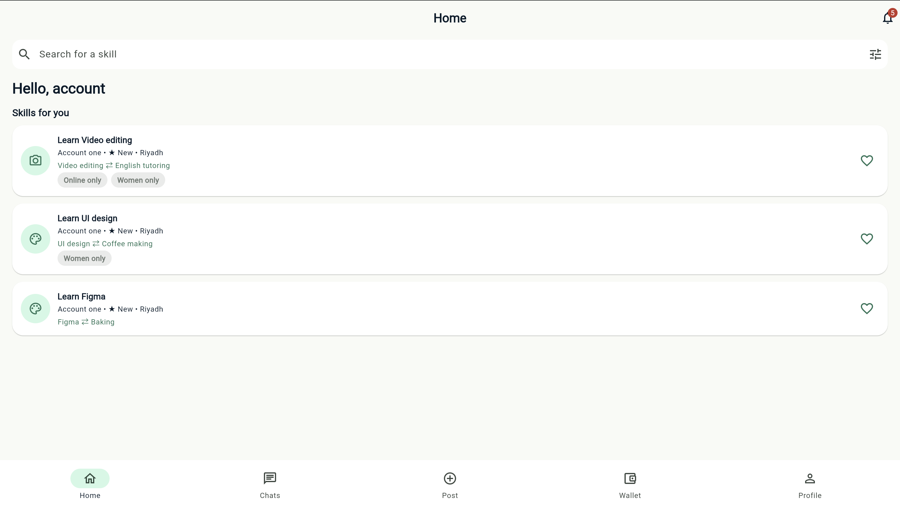
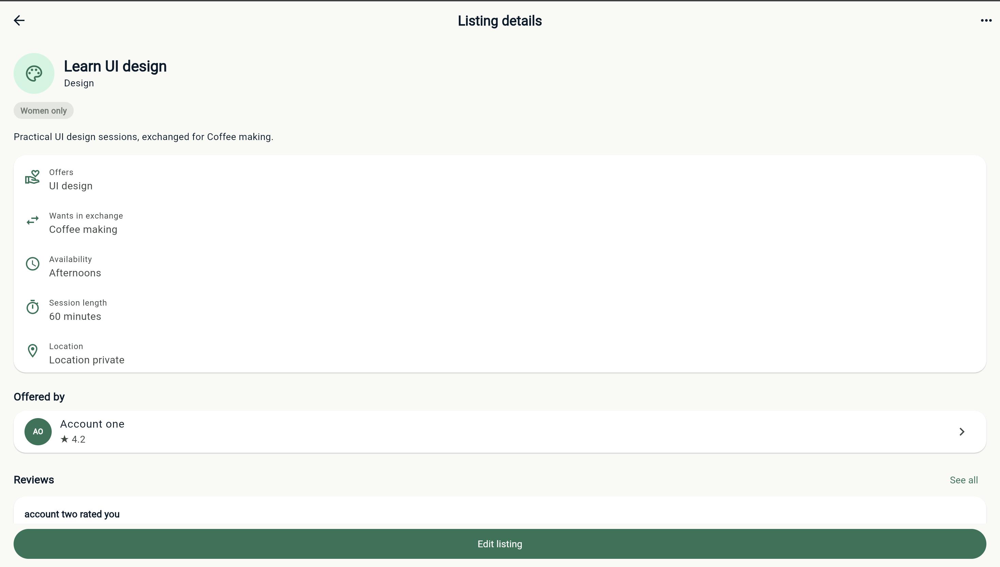
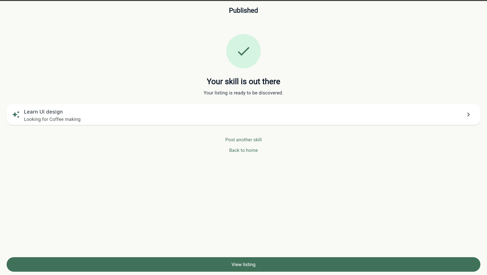
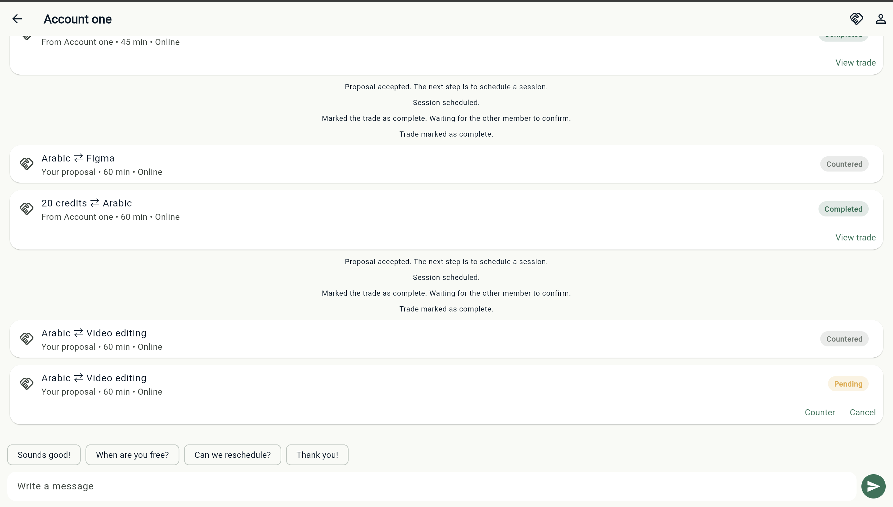
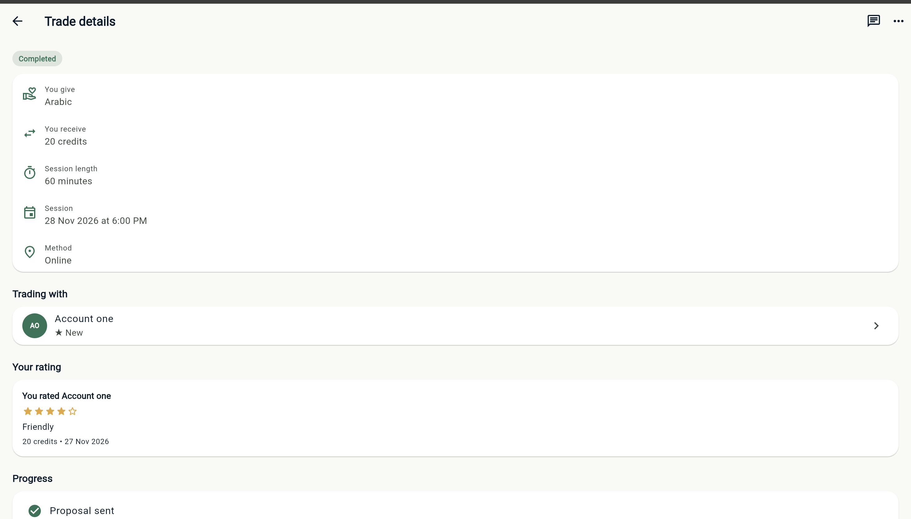
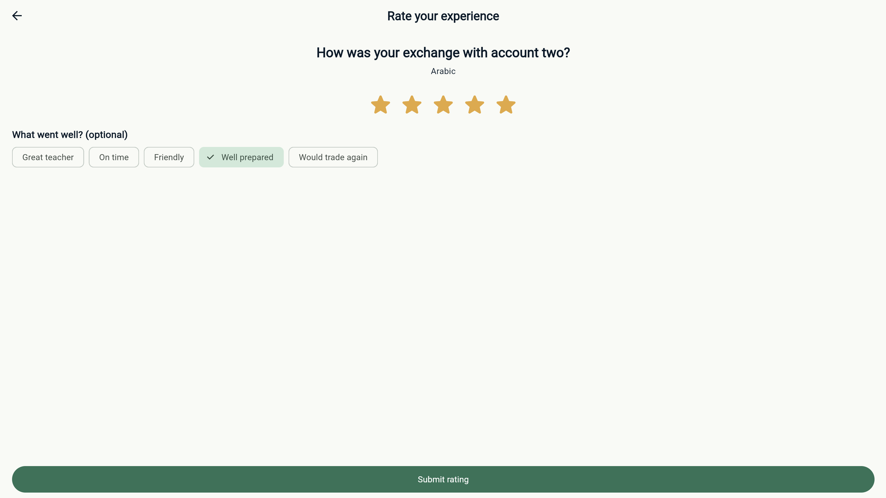
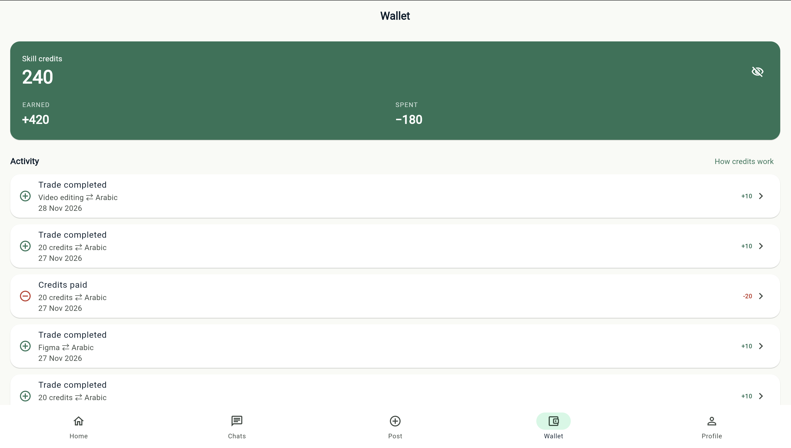
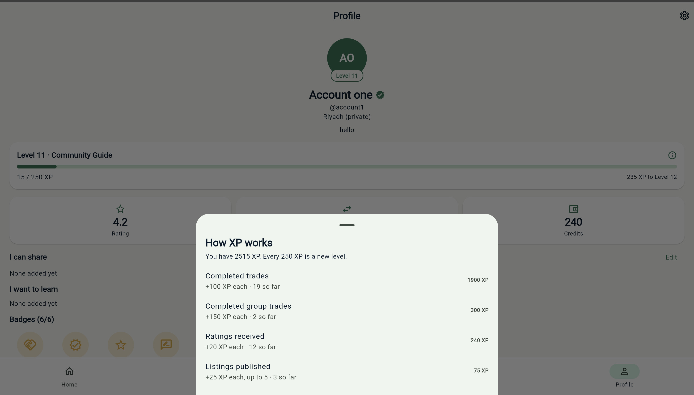
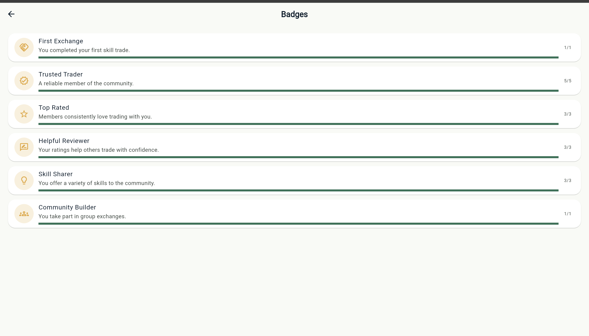
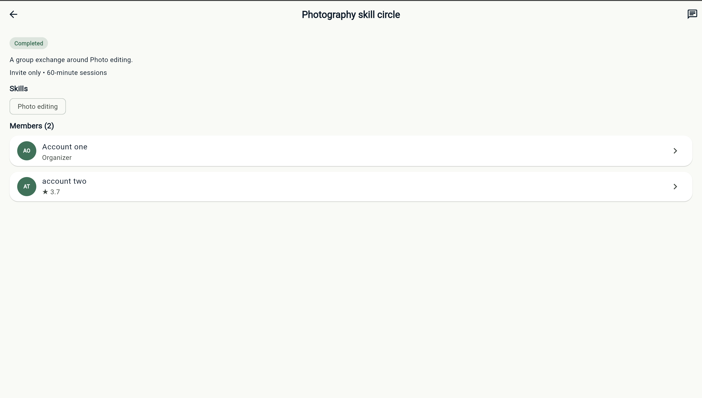

# Souq Skills screenshots

Screenshots captured by Raghad from the running application in Chrome on macOS.

[Back to the project README](../../README.md#screenshots)

### Home

Skill listings, search, filters and navigation.

### Listing details

Selected listing and trade proposal action.

### Posting validation

Required-field validation in the posting form.

### Chat and proposal

Trade conversation and proposal state.

### Completed trade

Completed exchange and its result.

### Rate an experience

Rating form for an eligible completed exchange.

### Skill wallet

Loaded credit balance and transaction history.

### Profile and XP

Profile information, level and XP.

### Badges

Badge progress and requirements.

### Group trade

Group members and invitation or completion state.

